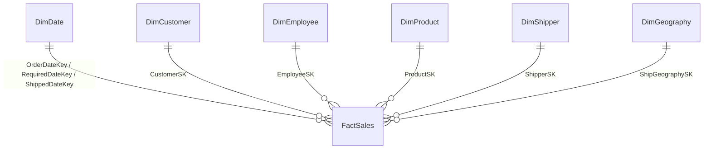

# ds-northwind

JORGE HUANCA BORGES

Data Warehouse (esquema estrella) construido sobre la base transaccional **Northwind**
en SQL Server, con carga incremental por `rowversion` implementada en T-SQL.
Proyecto del Diplomado · Módulo II: Almacenamiento y Preparación de Datos.

## Arquitectura

| Capa | Base de datos | Contenido |
|------|---------------|-----------|
| OLTP | `NorthWind`   | Esquema Northwind con `rowversion` en todas las tablas y procedimientos de extracción incremental |
| DW   | `NorthWindDW` | Dimensiones, tabla de hechos, área `staging`, control y bitácora del ETL en el esquema `etl` |

## Estructura del repositorio

```
src/
├── NorthWindOLTP/                  Proyecto de base de datos OLTP
└── NorthWindDW/                    Proyecto de base de datos del Data Warehouse
```

## Modelo estrella



**FactSales** — grano: una línea de pedido (`OrderID` + `ProductID`).
Medidas: `Quantity`, `UnitPrice`, `DiscountPct`, `GrossAmount`, `DiscountAmount`,
`NetAmount`, `FreightAllocated` (flete prorrateado), `DaysToShip`, `DaysLate`, `IsShipped`, `IsLate`.

| Dimensión      | Tipo de cambio | Notas |
|----------------|----------------|-------|
| `DimDate`      | estática       | 1996–2030, nombres EN/ES, semana ISO, fin de semana. Role-playing (pedido, requerida, envío) |
| `DimCustomer`  | SCD 2          | Histórico en City / Region / Country |
| `DimEmployee`  | SCD 2          | Histórico en Title, geografía y jefe; territorios y regiones aplanados |
| `DimProduct`   | SCD 2          | Histórico en UnitPrice, Discontinued, categoría y proveedor (desnormalizados) |
| `DimShipper`   | SCD 1          | Transportistas |
| `DimGeography` | SCD 1          | Destino de envío (país / región / ciudad) |

